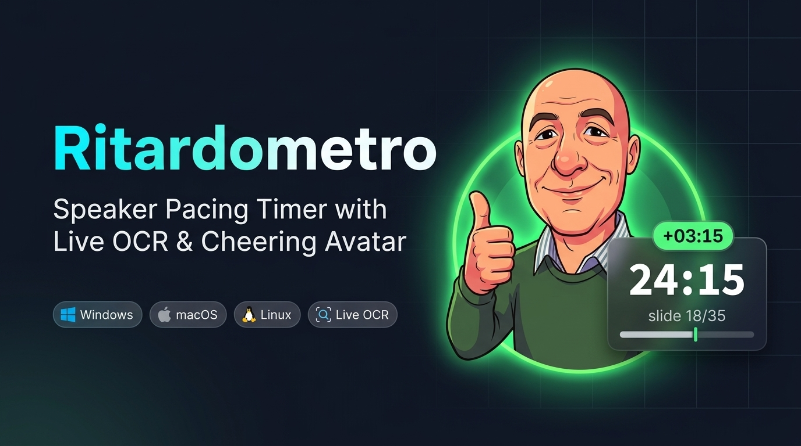
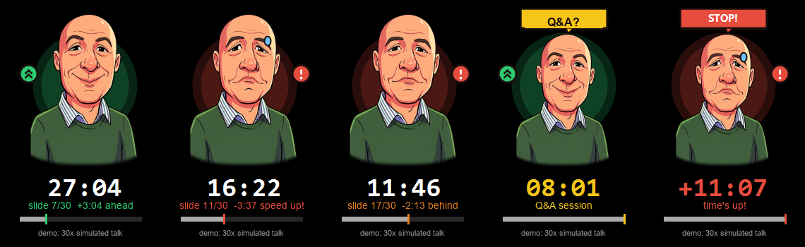
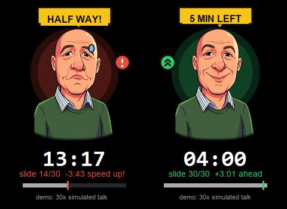

<p align="center">
  
</p>

# Ritardometro

The smart speaker pacing timer that tells you **whether you are ahead or behind schedule**, featuring an animated speaker caricature cheering you on (or panicking) in front of your audience.



Ritardometro stays always on top of your presentation, reads your current slide number from the screen in real-time, and compares it against your target pacing schedule:

- **Green aura & beacon**: you are ahead of time, feel free to slow down or elaborate
- **Red aura & beacon**: you are behind schedule, speed up
- **Expressive cartoon caricature**: smiles and nods when you are on track, frowns and worries when you fall behind, widens eyes and breaks into comic sweat drops when panic kicks in
- **Milestone speech balloons**: pop up at halfway (`HALF WAY!`), 5 minutes remaining (`5 MIN LEFT`), Q&A session (`Q&A?`), talk conclusion (`GREAT!`), and time expired (`STOP!`)



## How It Works

The core philosophy is **one slide per minute** (or your custom slide pacing ratio): for a 30-minute talk with 30 slides, at minute 12 you should ideally be around slide 13. Transition slides allow you to catch up, and Ritardometro gives you immediate live feedback.

1. A background thread captures the screen slide counter area (by default, the bottom-right corner where Marp and PDF presentation viewers display pagination). If nothing is readable there, it automatically scans the other corners and locks onto the one showing the counter.
2. The native OCR engine extracts the current slide and total (e.g. `14 / 35`).
3. Ritardometro calculates your time difference in seconds, updates the animated avatar, and adjusts the progress gauge.

When the slides carry no counter at all (so there is nothing to read), Ritardometro watches the screen instead: if it does not change for longer than `stuck_factor` times the average time per slide (`duration / total_slides`), the avatar taps their wrist to tell you that you are dwelling. This runs on Windows and macOS; on macOS the system asks for Screen Recording permission the first time, and `stuck_factor = 0` turns the whole thing off.

## Installation

Download the archive for your operating system from the [Releases page](https://github.com/matteobaccan/Ritardometro/releases/latest) and extract it anywhere:

| Platform | Archive |
|---|---|
| Windows 10/11 (x64) | `ritardometro-vX.Y.Z-windows-x64.zip` |
| Linux (x64) | `ritardometro-vX.Y.Z-linux-x64.tar.gz` |
| macOS Apple Silicon (M1/M2/M3…) | `ritardometro-vX.Y.Z-macos-arm64.tar.gz` |
| macOS Intel | `ritardometro-vX.Y.Z-macos-x64.tar.gz` |

> Automatic slide OCR detection runs natively on Windows via `Windows.Media.Ocr`. On macOS, Ritardometro watches the screen for slide changes instead (see `stuck_factor` below). On Linux it works as a full-featured pacing timer (with manual slide stepping via ← → arrow keys).
> On macOS the binary is unsigned: on first launch, use right-click → Open, or run `xattr -d com.apple.quarantine ./ritardometro`.
> On macOS the overlay joins every Space, so it stays visible over full-screen presentations (Preview, Keynote, PowerPoint), which run in a Space of their own.

The installed version and repository link are always visible at the bottom of the Settings window (right-click the avatar).

Or build it from source (requires [Rust](https://rustup.rs)):

```sh
cargo build --release
# binary is created in target/release/ritardometro(.exe)
```

## Publishing a New Version

1. Bump `version` in `Cargo.toml` (e.g. `1.0.0`) and commit.
2. Create and push the corresponding tag:
   ```sh
   git tag v1.0.0
   git push origin v1.0.0
   ```
3. The [`release.yml`](.github/workflows/release.yml) GitHub Action automatically validates the version, cross-compiles release binaries for Windows, Linux, and macOS (Apple Silicon + Intel), generates `SHA256SUMS.txt`, and publishes the release.

## Usage

```sh
ritardometro.exe                          # uses ritardometro.toml located next to executable
ritardometro.exe devsecopsday.toml        # custom config file for a specific talk
ritardometro.exe --minutes 25 --slides 28 # override duration and slide count on the fly
ritardometro.exe --demo                   # demo mode: simulates a 30-minute talk in ~1 minute
```

| Option | Description |
|---|---|
| `file.toml` | config file to load (default: `ritardometro.toml` next to the executable) |
| `-m N`, `--minutes N` | talk duration in minutes (accepts decimals, e.g. `12.5` or `12,5`) |
| `-s N`, `--slides N` | total slide count (`0` = auto-detect total from screen e.g. "12 / 40") |
| `--demo` | demo mode: accelerated 30x talk simulation without OCR |
| `-h`, `--help` | display command line help |

On first launch, a documented `ritardometro.toml` file is automatically created.

Before stepping on stage:

1. Open your presentation slides in full screen (duplicated display).
2. Launch Ritardometro: it appears in your configured corner (default: top-right); drag and resize it anywhere, including across multiple monitors.
3. It starts automatically as soon as you transition from slide 1 to slide 2, or upon first click.

### Keyboard Shortcuts

Keys work when the overlay is focused (click on it); during your talk, your focus stays on the presentation viewer so slide clickers and arrow keys advance slides normally.

| Key | Action |
|---|---|
| `Space` | Start / Pause timer (in pause, OCR stops capturing the screen) |
| `R` | Reset timer and milestone flags |
| `+` (or `=`) | Elapsed time +1 minute |
| `-` | Elapsed time −1 minute |
| `→` or `PageDown` | Next slide (manual correction or non-OCR mode) |
| `←` or `PageUp` | Previous slide |
| `Ctrl` + `+` | Increase overlay size |
| `Ctrl` + `-` | Decrease overlay size |
| `Ctrl` + `0` | Reset size to 100% |
| `Esc` or `Q` | Close Settings window if open, otherwise quit the application |

### Mouse Controls

| Gesture | Action |
|---|---|
| Left click on overlay | Start / Pause |
| Left click and drag | Move overlay (smooth multi-monitor support) |
| Drag edge or corner | Corner-anchored resize (the opposite corner stays fixed) |
| Mouse wheel | Zoom / resize overlay smoothly |
| Right click | Open / close Settings window |

### Settings Window (Right Click)

| Control | Description |
|---|---|
| Pause / Start, Reset | Same as `Space` and `R` |
| Time −1 / +1 min | Adjust elapsed talk time |
| Slide −1 / +1 | Manually step slide number |
| Size − / + / 100% | Scale overlay size |
| OCR Monitor: Auto | Captures the display where Ritardometro currently resides |
| Detected Displays: Mon 1, Mon 2… | Pin OCR capture to a specific display |
| Auto-detect: Find the slide counter in any corner | Scans the other corners when the configured area reads nothing, and locks onto the one with the counter |
| Highlight OCR Zone on Screen | Flashes a spotlight border over the active OCR capture area |
| OCR Rate | Polling interval (200 / 350 / 500 ms) |
| Save ritardometro-debug.png | Saves raw OCR captures for tuning capture boundaries |
| Transparency: Background, Avatar & Text | Independent opacity controls for HUD and avatar |
| Open Configuration File | Opens `ritardometro.toml` in your default text editor |
| Ritardometro vX.Y.Z · GitHub | Current version & direct link to GitHub repository |
| Close Menu / Quit App | Dismiss window or exit application |

Changes made via the Settings window apply immediately to your active session; edit `ritardometro.toml` to make them permanent defaults.

## Configuration

All options available in `ritardometro.toml`:

```toml
duration_minutes = 30     # Talk duration in minutes (excluding Q&A)
questions_minutes = 10    # Q&A countdown duration in minutes (0 = none)
total_slides = 30         # Total slides (0 = auto-detect total from screen e.g. "12 / 40")
auto_start = true         # Auto-start timer when advancing from slide 1 to 2
tolerance_seconds = 60    # Seconds of delta considered "on track"
panic_seconds = 180       # Seconds behind schedule before avatar panics
scale = 1.0               # Initial overlay scale factor
background_opacity = 0.70 # HUD background box opacity (0.0 - 1.0)
opacity = 1.0             # Avatar and text opacity (0.15 - 1.0)
stuck_factor = 1.5        # No slide counter: tap the wrist after this many times the
                          # average time per slide (0 = never watch the screen)
position = "top-right"    # Initial corner: "top-left", "top-right", "bottom-left", "bottom-right"
margin = 24               # Margin from screen edge in points

[ocr]
enabled = true            # false = timer-only mode (no OCR)
monitor = 0               # 0 = auto (follows overlay monitor), 1, 2, 3... = fixed monitor
auto_zone = true          # look for the counter in the other corners if the box below reads nothing
# Slide counter bounding box in screen fractions (default: bottom-right corner)
x = 0.85
y = 0.88
width = 0.15
height = 0.12
interval_ms = 250         # OCR capture interval in milliseconds
magnification = 3         # Pre-OCR scaling factor
save_debug = false        # true = save capture to ritardometro-debug.png

[[milestone]]
percentage = 50
text = "HALF WAY!"

[[milestone]]
minutes_left = 5
text = "5 MIN LEFT"
```

You can define as many `[[milestone]]` sections as needed, using either `percentage` of talk duration or `minutes_left`.

### Troubleshooting OCR

- OCR captures the **monitor display region** (independent of window focus): with `monitor = 0` it captures the monitor where Ritardometro is located. Use **Highlight OCR Zone on Screen** in Settings to inspect which screen and bounding box are being captured.
- If your slides number pages somewhere other than the bottom-right corner, you normally do not need to configure anything: after a few seconds without a reading, Ritardometro scans the other corners and stays on the one where it finds the counter (the status line then shows e.g. `OCR ok: slide 12/40 @ bottom-left`). Set `auto_zone = false` to always capture the configured box only.
- Enable **Save ritardometro-debug.png** in Settings (or `save_debug = true`) and inspect `ritardometro-debug.png`: it should tightly frame your slide counter numbers. Adjust `x`, `y`, `width`, `height` if needed.
- Do not place the Ritardometro overlay directly on top of the slide counter: it would capture its own slide number. With `auto_zone = true` it detects the overlap and moves the capture to another corner by itself.
- Windows OCR uses installed system language packs. If you see an OCR unavailable message, install a language pack with optical character recognition under *Settings > Time & Language > Language*.
- In Marp presentations, a formatted counter like `12 / 40` works reliably:

  ```css
  section::after { content: attr(data-marpit-pagination) ' / ' attr(data-marpit-pagination-total); }
  ```

## Architecture

| File | Role |
|---|---|
| `src/main.rs` | CLI arguments, window setup and entry point |
| `src/app.rs` | Main overlay application: talk state machine, rendering, resizing, multi-monitor dragging, settings window |
| `src/avatar.rs` | Animated 2D deformable mesh caricature (facial expressions, breathing, sweat drops, comic speech balloons) |
| `src/pacing.rs` | Pure pacing logic: stopwatch, delta calculation, pacing judgments, milestones (with unit tests) |
| `src/ocr/` | Screen capture (`xcap`), Windows OCR integration, regex parsing |
| `src/config.rs` | `ritardometro.toml` loading, validation and defaults |

UI rendered via [egui/eframe](https://github.com/emilk/egui) with OpenGL (Glow) backend for rock-solid transparent window composition across Windows, Linux and macOS.

```sh
cargo test   # run pacing logic, OCR parser, and configuration tests
```

## License

MIT
